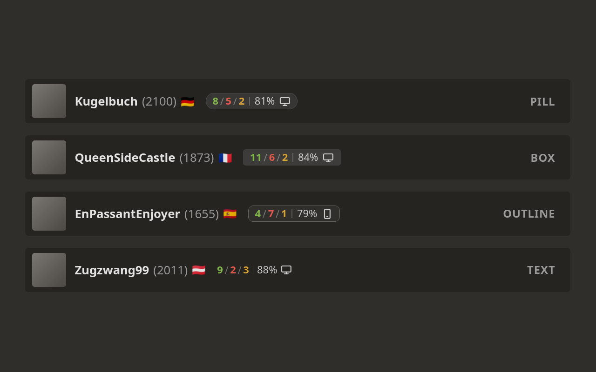
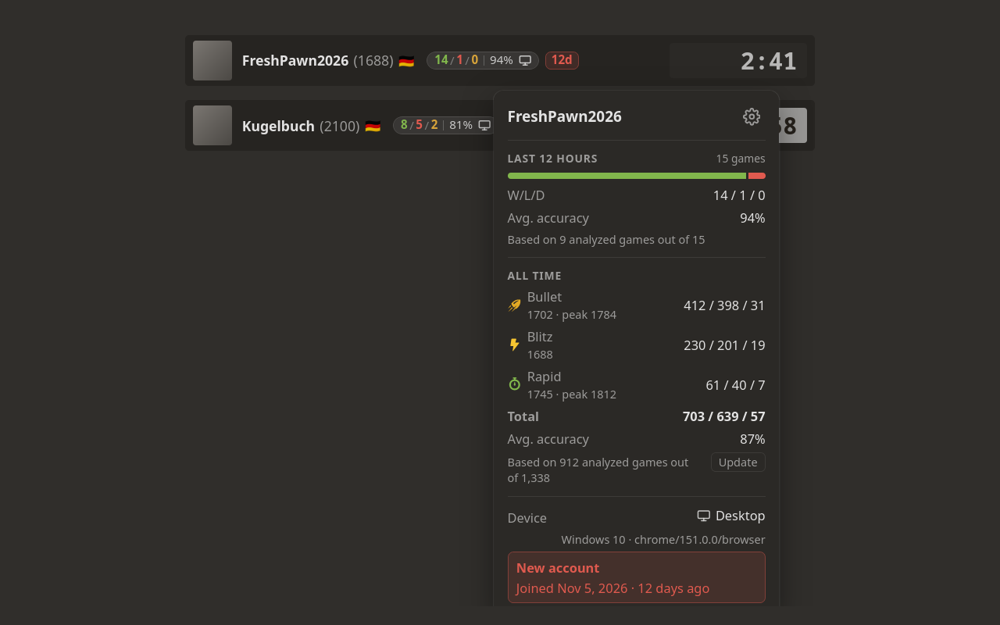
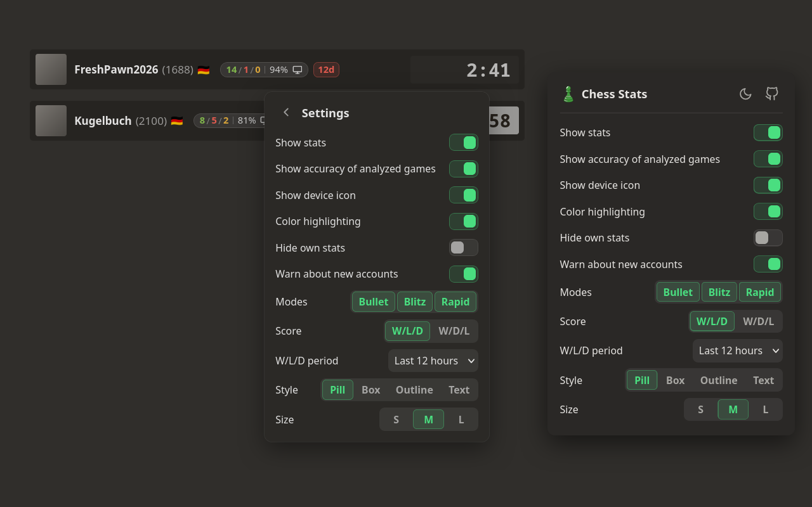

# chess-com-insights

[](https://github.com/thieleju/chess-com-insights/actions/workflows/release.yml)
[](https://github.com/thieleju/chess-com-insights/actions/workflows/tests.yml)


## 🚀 How it works

This extension shows statistics for chess.com games.
Use the extensions icon in your browser in the top right corner to adjust the settings.

- First three numbers are the wins/loses/draws of the player
- Percentage in brackets is the average accuracy of the player
  - Accuracy is only available on reviewed games
  - Hover over the stats to see information how many games the average is based on

### Preview




### Options



## ⚙️ Installation

Add the extension to your browser:
[Chrome Web Store](https://chrome.google.com/webstore/detail/chesscom-insights/mobpnhbkmljienoleojnhbfhkhodpffe)

Manual installation:

- Download the latest release zip from [here](https://github.com/thieleju/chess-com-insights/releases)
- Go to your browser and type `chrome://extensions/` in the search bar
- Enable developer mode in the corner
- Drag and drop the zip file into the browser window

## 💻 Run locally

Prerequisites: Node.js 22 or higher and [pnpm](https://pnpm.io)

```bash
pnpm install
pnpm dev              # Chrome with hot reload
pnpm dev:firefox      # Firefox with hot reload
pnpm build            # .output/chrome-mv3
pnpm build:firefox    # .output/firefox-mv3
pnpm zip && pnpm zip:firefox   # release zips in .output
```

Checks:

```bash
pnpm typecheck
pnpm lint
pnpm test             # vitest
pnpm cover            # coverage report in tests/coverage
```

## 💯 Code Coverage Report

[Code Coverage Report](https://thieleju.github.io/chess-com-insights/) served with github pages

## License

This project is licensed under the MIT License - see the [LICENSE](LICENSE) file for details.
This extension is an independent project and is not affiliated with, endorsed by, or associated with Chess.com in any way.
